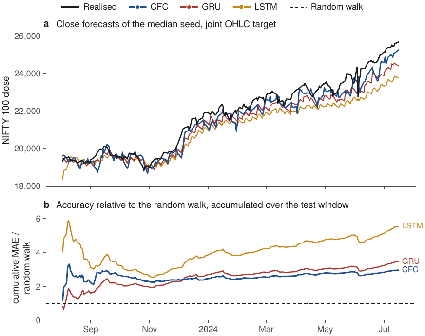

# CFCNet: gating vs non-gating recurrent networks for equity-index forecasting

Code, configuration, run logs and figure/table scripts for the paper

> **CFCNet: A Comparative Study on the Performance of Gating and Non-Gating Neural Network
> Architectures in Equity Market Prediction**
> Rishov Nag, Chiraag Banerjee, Sankhayan Choudhury, Sanjit Kumar Setua
> Department of Computer Science and Engineering, University of Calcutta.
> *Computational Economics* (under review).

The study compares two continuous-time, non-gating recurrences from the Neural-ODE family —
**Closed-form Continuous-time networks (CfC)** and **Liquid Time-Constant networks (LTC)** — with the
gated **LSTM** and **GRU** on one-step-ahead forecasting of daily equity-index prices: the next
session's adjusted close and its joint Open, High, Low and Close (OHLC) vector, for NIFTY 50, NIFTY 100
and NIFTY 500, with the S&P 500, Nikkei 225 and SSE Composite as a cross-market validation set.

Every table and figure of the paper, and every result number quoted in its text, is generated by the
scripts in this repository from the run logs in `runs/`. Nothing is typed by hand.

---

## Contents

1. [Quick start](#quick-start)
2. [What the code does](#what-the-code-does)
3. [Information timing and protocol](#information-timing-and-protocol)
4. [Models](#models)
5. [Data](#data)
6. [Reproducing the paper](#reproducing-the-paper)
7. [Run logs and artefacts](#run-logs-and-artefacts)
8. [Repository layout](#repository-layout)
9. [Tests](#tests)
10. [Compute, hardware and determinism](#compute-hardware-and-determinism)
11. [Figure style](#figure-style)
12. [Citation and licence](#citation-and-licence)

---

## Quick start

```bash
git clone https://github.com/rishovnag/cfcnet.git
cd cfcnet
python -m venv .venv && source .venv/bin/activate        # Python 3.10-3.13
pip install -r requirements.txt && pip install -e .
pytest -q                                                 # 27 tests, about 1-2 minutes on a laptop CPU
```

**Regenerate every table and figure from the released run logs** (minutes, no training):

```bash
python data/download_data.py --end 2026-10-01             # the six index series (Yahoo Finance)
python data/download_data.py --primary                     # the NIFTY 100 primary sample (to 2024-07-16)
python scripts/01_diagnostics.py                           # data facts, Tables 2-3
python scripts/09_data_figures.py                          # Figures 1-5 and 11
python scripts/06_dm_tests.py                              # Diebold-Mariano tests (Table 6)
python scripts/07_make_tables.py                           # every results table + results_facts.tex
python scripts/08_make_figures.py                          # every results figure
```

Outputs are written to `results/tables/` and `results/figures/`; add `--paper-dir <folder>` to
also write them into a LaTeX manuscript folder. The figure scripts need the per-run forecasts, which
are attached to the GitHub release (see [Run logs and artefacts](#run-logs-and-artefacts)).

**Re-run every experiment from scratch** (several days on one workstation; resume-safe):

```bash
bash scripts/run_all.sh [<paper-folder>] [--workers=N]    # CPU reference path
bash gpu/run_all_gpu.sh [<paper-folder>]                   # optional CUDA GPU backend (see gpu/README.md)
```

---

## What the code does

| | |
|---|---|
| **Architectures** | CfC and LTC (`ncps`, `AutoNCP` wiring), LSTM and GRU (one recurrent layer + dense readout) |
| **Targets** | `adjclose`: the next session's adjusted close (1 output) · `ohlc`: the next session's (O, H, L, C) (4 outputs) |
| **Representations** | `levels`: Min–Max-scaled price levels · `returns`: log returns relative to the forecast-origin close, mapped back to levels |
| **Widths** | `adjclose`: 20 units, ablation 7 (CfC/LTC `AutoNCP(20, 1)`) · `ohlc`: 80 units, ablation 28 (`AutoNCP(80, 4)`) |
| **Benchmarks** | random walk, close-anchored naive forecast (OHLC), ARIMA(p,1,q) with drift |
| **Measures** | R², RMSE, MAE (joint and per column), MASE, directional accuracy, returns R², Diebold–Mariano (HLN) |

The experiment grid (all defined in `configs/paper.yaml`):

| Experiment | Paper | Indices | Seeds | Runs | Script |
|---|---|---|---|---|---|
| Headline comparison and robustness (primary sample, test Aug 2023 – Jul 2024) | §6.3–6.4 | NIFTY 100 | 10 | 240 | `scripts/10_primary_window.py` |
| Extended fixed-origin comparison, both representations (`headline`) | §6.3 | NIFTY 100 | 30 | 480 | `scripts/02_fixed_origin.py --experiment headline` |
| Width ablation (`capacity`) | §6.5 | NIFTY 100 | 30 | 480 | `scripts/02_fixed_origin.py --experiment capacity` |
| Train–test split (`split_sweep`, 80–20 to 95–5) | §6.6 | NIFTY 100, NIFTY 500 | 30 | 960 | `scripts/02_fixed_origin.py --experiment split_sweep` |
| Cross-market validation (`cross_market`) | §6.9 | NIFTY 50, S&P 500, Nikkei 225, SSE | 30 | 1,920 | `scripts/02_fixed_origin.py --experiment cross_market` |
| Walk-forward evaluation, 15 one-year folds (2011–2026) | §6.8 | NIFTY 100 | 3 | 720 | `scripts/04_walk_forward.py` |
| History-length ablation (5 to 19 trading years) | §6.8 | NIFTY 100 | 3 | 120 | `scripts/05_history_ablation.py` |
| Benchmarks (random walk, naive, ARIMA) | all | all | – | 60 | `scripts/03_baselines.py` |

In total 4,800 training runs (4,680 distinct; the NIFTY 100 95–5 cell of the split experiment
re-runs the extended headline CfC cell and is dropped from the tables).

### Main results at a glance

On the NIFTY 100 headline window (95–5 split, test targets 3 August 2023 – 16 July 2024, models
trained on price levels, medians over seeds; `results/tables/table_primary.csv`):

| Joint OHLC target | R² | Best R² | MASE | Parameters |
|---|---|---|---|---|
| **CfC (80, 4)** | **0.935** | **0.957** | **2.960** | **19,736** |
| GRU-80 | 0.916 | 0.929 | 3.515 | 21,684 |
| LSTM-80 | 0.768 | 0.845 | 5.884 | 28,484 |
| LTC (80, 4) | −3.428 | −2.301 | 27.7 | 28,102 |
| Random walk | 0.989 | – | 1 | – |

CfC attains the highest R² and a MASE 16% below GRU's with 31% fewer parameters than an LSTM of equal
width, and the R² values are robust to the target alignment, the scaler fit and the seed selection
(Section 6.4). The extended evaluation delimits the advantage: CfC is the most accurate levels-trained
architecture on every long-history fixed-origin window that trends above its training range
(NIFTY 100 2023–24, S&P 500, Nikkei 225), the gated baselines lead on range-bound windows and on
the short rolling windows of the walk-forward evaluation, and — measured against the random walk —
no architecture forecasts the closing level with skill; the forecastable component of the joint
OHLC target is the next session's open and intraday range.

<p align="center">
  
</p>

---

## Information timing and protocol

At the close of session *t* the model observes seven channels

    u_t = (Open_t, High_t, Low_t, Volume_t, AdjClose_t, Close_t, weekday_t)

and forecasts a quantity of session *t+1*: `AdjClose_{t+1}` (`adjclose`) or
`(Open, High, Low, Close)_{t+1}` (`ohlc`). Training pairs are `(u_t, y_{t+1})`; a causal recurrent
network reads its forecast for *t+1* from its output at step *t*, so no part of a target is ever an
input at or before its forecast origin. `tests/test_pipeline.py` verifies this by perturbing a session and
checking that no input row whose forecast origin precedes it changes.

In the `returns` representation the inputs are log changes relative to session *t−1*, the target is
`log(y_{t+1} / C_t)` (or `log(AdjC_{t+1} / AdjC_t)`), and forecasts are mapped back to levels as
`C_t · exp(r̂)`.

Every experiment uses the same preprocessing (`src/cfcnet/data.py`; Algorithms 1–2 of the paper):

1. **Split.** Strictly chronological, no shuffling. For fixed-origin experiments
   `n_test = ceil(test_frac · n)`, identical to `sklearn.train_test_split(shuffle=False)`.
2. **Scaling.** Three Min–Max scalers, all **fitted on the training pairs only**: inputs (the weekday
   channel is not scaled), model-space targets, and target levels. The level scaler defines the
   common evaluation scale; test values may fall outside [0, 1].
3. **Warm-up.** The test pass starts from a zero hidden state and is preceded by 10 warm-up sessions
   from the end of the training window, excluded from every metric.
4. **Evaluation.** Every metric is computed on the scaled price levels, whatever representation the
   model was trained in, so levels models, returns models and benchmarks are compared on identical
   numbers.

**Training** (identical for all architectures): Adam, learning rate 1e-3, no schedule, MSE loss,
400 epochs, batch dimension 1; the full training sequence is consumed in one pass per epoch as a
tensor of shape `(1, m, 7)`; no dropout, weight decay or gradient clipping. A run *diverges* when its
loss or forecasts become non-finite; diverged runs are kept in the logs, excluded from statistics and
counted in the tables.

**Robustness protocols.** `scripts/10_primary_window.py` also trains the headline models under two
alternative protocols — a same-session target (`timing="same_day"`), with the scalers fitted on the
training window or on the full series (`scaler_fit="full"`) — to measure how far the headline depends
on these choices (Section 6.4, Table 8, Figure 10). These options exist only for that analysis and
are never used by a forecasting experiment.

**Benchmarks.** The random walk carries every target component forward (`ŷ_{t+1} = y_t`). For the
OHLC target the close-anchored naive forecast predicts all four prices by `C_t`. ARIMA(p,1,q) with
drift is fitted per column on the training window (p, q ∈ {0,1,2} by AIC) and issues one-step-ahead
forecasts with fixed parameters and updated information (`src/cfcnet/baselines.py`).

**Measures** (`src/cfcnet/metrics.py`, `src/cfcnet/stats.py`): joint and per-column R², RMSE and MAE;
MASE = MAE / MAE of the random walk (below 1 beats it); directional accuracy of the forecast close
change; R² of the implied log returns; Diebold–Mariano tests with the Harvey–Leybourne–Newbold
correction at h = 1 on the daily joint squared error.

---

## Models

`src/cfcnet/models.py` builds CfC and LTC with the `ncps` reference implementation:

```python
from ncps import wirings
from ncps.keras import CfC, LTC                  # falls back to ncps.tf on older installs
wiring = wirings.AutoNCP(units, motor)           # motor = 1 (adjclose) or 4 (ohlc): the motor neurons are the outputs
model = keras.Sequential([keras.layers.InputLayer(shape=(None, 7)), CfC(wiring, return_sequences=True)])
```

LSTM and GRU use one recurrent layer followed by `Dense(motor)`. Trainable parameters (checked by
`pytest` against Table 10 of the paper):

| Target | CfC | LTC | LSTM | GRU |
|---|---|---|---|---|
| `ohlc`, default width | (80, 4): 19,736 | (80, 4): 28,102 | 80: 28,484 | 80: 21,684 |
| `ohlc`, ablation | (28, 4): 2,504 | (28, 4): 4,026 | 28: 4,148 | 28: 3,224 |
| `adjclose`, default width | (20, 1): 1,556 | (20, 1): 2,236 | 20: 2,261 | 20: 1,761 |
| `adjclose`, ablation | (7, 1): 264 | (7, 1): 429 | 7: 428 | 7: 344 |

`src/cfcnet/guard.py` implements the out-of-envelope deployment guard discussed in Section 6.8.

---

## Data

All series are daily sessions from Yahoo Finance (`yfinance`, unadjusted prices plus the vendor's
`Adj Close`). **The data files are not included in the repository**; the download script recreates
them, and `data/checksums.sha256` identifies the exact files used in the paper:

```bash
python data/download_data.py --end 2026-10-01    # data/raw/*.csv, data/manifest.json, data/checksums.sha256
python data/download_data.py --primary           # data/primary/NIFTY100_2024-07-16.csv (checksum reported)
cd data && sha256sum -c checksums.sha256         # macOS: shasum -a 256 -c checksums.sha256
```

| Index | Ticker | Extended sample used in the paper |
|---|---|---|
| NIFTY 50 | `^NSEI` | 17 Sep 2007 – 30 Sep 2026 |
| NIFTY 100 | `^CNX100` | 30 Nov 2005 – 30 Sep 2026 (primary sample: to 16 Jul 2024) |
| NIFTY 500 | `^CRSLDX` | 26 Sep 2005 – 30 Sep 2026 |
| S&P 500 | `^GSPC` | 3 Jan 1972 – 30 Sep 2026 (vendor history from 1927; earlier sessions have O = H = L = C) |
| Nikkei 225 | `^N225` | 8 Apr 1988 – 30 Sep 2026 (vendor history from 1965; earlier sessions have O = H = L = C) |
| SSE Composite | `000001.SS` | 2 Jul 1997 – 30 Sep 2026 |

Vendors revise history, so a fresh download can differ from the files used in the paper; the
checksums tell you whether it does. Early S&P 500 and Nikkei 225 history in which the vendor reports
O = H = L = C is excluded automatically (`start: auto_ohlc`). See [`data/README.md`](data/README.md)
for the schema, cleaning rules and the sample-start rule, and
[`data/primary/README.md`](data/primary/README.md) for the primary sample.

---

## Reproducing the paper

The manuscript reads every data-dependent number from `data_facts.tex`, every result number from
`results_facts.tex` and every table body from `table_*.tex`; the figures are `fig_*.pdf`. All are
written by the scripts below (into `results/`, and into a manuscript folder with `--paper-dir`).
Table and figure numbers refer to the submitted manuscript.

| Paper item | Command | Reads | Writes |
|---|---|---|---|
| Data facts (§2, §6.1), Tables 2–3 | `python scripts/01_diagnostics.py` | `data/` | `data_facts.tex`, `test_windows_rows.tex`, `dataset_stats_rows.tex` |
| Figures 1–5 and 11 (data, schematics, wirings) | `python scripts/09_data_figures.py` | `data/` | `fig_flow`, `fig_ncp_architecture`, `fig_index_histories`, `fig_indices_normalised`, `fig_return_correlation`, `fig_wiring_cfc` |
| Headline and robustness runs | `python scripts/10_primary_window.py` | `data/primary/` | `runs/primary_window.csv` |
| Extended fixed-origin runs | `python scripts/02_fixed_origin.py --experiment headline capacity split_sweep cross_market` | `data/raw/` | `runs/fixed_origin.csv` |
| Benchmarks | `python scripts/03_baselines.py` | `data/raw/` | `runs/baselines.csv` |
| Walk-forward runs | `python scripts/04_walk_forward.py` | `data/raw/` | `runs/walk_forward.csv`, `runs/walk_forward_folds.csv`, `runs/adf_per_fold.csv` |
| History-length ablation | `python scripts/05_history_ablation.py` | `data/raw/` | `runs/history_ablation.csv` |
| Diebold–Mariano tests | `python scripts/06_dm_tests.py` | `runs/*.csv`, `runs/predictions/` | `runs/dm_vs_rw.csv`, `runs/dm_pairwise.csv` |
| Per-column skill | `python scripts/11_skill_decomposition.py` | `runs/predictions/` | `runs/skill.csv` |
| Latency benchmark (serial, idle machine) | `python scripts/12_latency.py --device cpu --repeats 30` | `data/raw/` | `runs/latency_cpu.csv` |
| **Tables 4–17** and every result number | `python scripts/07_make_tables.py` | `runs/*.csv` | `table_*.tex` (+ CSV), `results_facts.tex` |
| **Figures 6–10, 12–18** | `python scripts/08_make_figures.py` | `runs/` | `fig_*.pdf` |

Table files: 4 `table_primary` · 5 `table_test` · 6 `table_dm` · 7 `table_skill` · 8 `table_robustness` ·
9 `table_capacity` · 10 `table_params_latency` · 11 `table_split_sweep` · 12 `table_repr` ·
13 `table_wf_folds` · 14 `table_wf_summary` · 15 `table_wf_regime` · 16 `table_history` ·
17 `table_cross_market`.

Figure files: 6 `fig_primary` · 7 `fig_seed_variability` · 8 `fig_skill` · 9 `fig_actual_predicted` ·
10 `fig_robustness` · 12 `fig_pareto` · 13 `fig_ltc_loss` · 14 `fig_extrapolation` ·
15 `fig_wf_timeline` · 16 `fig_wf_fold_anatomy` · 17 `fig_wf_history` · 18 `fig_cross_market`.

`scripts/run_all.sh` runs the whole sequence. Every training script is **resume-safe**: it reads the
existing log and skips finished runs, so an interrupted run can simply be restarted. Useful options
(all training scripts):

```bash
--workers N        # parallel runs (default: all CPU cores); --threads N per run (default 1)
--gpu-workers N    # LSTM runs on an Apple-silicon / CUDA GPU (see "Compute" below)
--seeds 0-9        # a subset of seeds;  --targets ohlc;  --reprs levels;  --arch cfc gru
--epochs 2 --out runs_smoke   # smoke test into a scratch folder
--config FILE --data-dir DIR  # alternative configuration or data folder
```

A smoke test of the full pipeline takes a few minutes:

```bash
python scripts/02_fixed_origin.py --experiment headline --targets ohlc --reprs levels --seeds 0-1 --epochs 2 --out runs_smoke
```

---

## Run logs and artefacts

`runs/` holds one CSV log per experiment, committed to the repository:

| File | One row per | Key columns |
|---|---|---|
| `fixed_origin.csv` | extended fixed-origin run | `experiment, index, target, repr, arch, units, seed, test_frac` |
| `primary_window.csv` | headline / robustness run | `data, target, timing, scaler_fit, arch, units, seed` |
| `walk_forward.csv` | walk-forward run | `fold, regime, target, repr, arch, seed` |
| `history_ablation.csv` | history-ablation run | `hist_years, target, repr, arch, seed` |
| `baselines.csv` | benchmark forecast | `index, target, test_frac, model` (`rw`, `naive_close`, `arima`) |
| `dm_vs_rw.csv`, `dm_pairwise.csv` | DM test | statistic, p-value, direction |
| `skill.csv` | run | per-column MASE and relative MAE against the naive forecast |
| `latency_cpu.csv` | configuration | median, p10, p90 latency per pass and per session |
| `walk_forward_folds.csv`, `adf_per_fold.csv` | fold | dates, regime, extrapolation share, ADF tests |
| `environment*.json` | environment | Python, NumPy, pandas, scikit-learn, statsmodels, TensorFlow, Keras, ncps versions, platform |

Every training row also records the window dates, `n_params`, `n_train`, `n_test`, `last_loss`,
`train_time_s`, `test_time_s`, `latency_ms_per_day`, `status` (`ok` / `diverged`), the joint and
per-column `r2_*`, `rmse_*`, `mae_*`, `mase`, `da` and `r2_ret`.

Each run also writes its test forecasts (`runs/predictions/<run_id>.npz`: dates, scaled and unscaled
forecasts, realised values and the random walk) and its per-epoch training loss
(`runs/histories/<run_id>.json`). Because of their size (about 220 MB) these are **not** in git; they
are attached to the GitHub release as `cfcnet-run-artefacts.tar.gz`. Unpack it at the repository root
before running `06`, `08` or `11` on the released logs:

```bash
tar xzf cfcnet-run-artefacts.tar.gz        # creates runs/predictions/ and runs/histories/
```

---

## Repository layout

```
cfcnet/
├── README.md                  this file
├── configs/
│   ├── paper.yaml             protocol, targets, representations, widths, experiment grids
│   └── gpu.yaml               runtime settings of the optional GPU backend
├── data/
│   ├── download_data.py       Yahoo Finance download (+ --primary), manifest and checksums
│   ├── manifest.json, checksums.sha256
│   ├── raw/                   the six index series (not in git)
│   └── primary/               the NIFTY 100 primary sample (not in git) and its README
├── src/cfcnet/
│   ├── data.py                loading, genuine-OHLC start, (u_t, y_{t+1}) pairing, windows, scaling
│   ├── models.py              CfC / LTC (ncps AutoNCP) and LSTM / GRU
│   ├── train.py               seeding, reference training (model.fit), evaluation and logging of one run
│   ├── parallel.py            process pool for the reference path (CPU, optional GPU for LSTM)
│   ├── metrics.py             R2, RMSE, MAE, MASE, returns R2, directional accuracy
│   ├── baselines.py           random walk, close-anchored naive, ARIMA
│   ├── stats.py               Diebold-Mariano (HLN), ADF / KPSS, Engle-Granger
│   ├── guard.py               out-of-envelope deployment guard
│   ├── io.py, cli.py          configuration, logs, environment record, command-line options
│   ├── style.py, fonts/       the journal figure style and its bundled font
│   └── fast.py, jobs.py, worker.py, gpuenv.py    optional GPU backend
├── scripts/                   01-12: the pipeline steps; run_all.sh
├── gpu/                       optional GPU backend: plan, parallel runner, status, merge, autotune, MPS, set-up
├── runs/                      run logs (CSV, committed); predictions/ and histories/ from the release
├── results/
│   ├── tables/                generated table bodies (.tex, .csv), data_facts.tex, results_facts.tex
│   └── figures/               generated figures (.pdf)
├── docs/images/               figure previews for this README
└── tests/                     pytest suite
```

---

## Tests

```bash
pytest -q
```

The suite (27 tests) checks, among other things, that:

- targets are the next session's values, for both targets and both representations, and inputs never
  see the future (perturbing a session leaves every earlier input row unchanged);
- the two representations share identical pairs, windows and test dates;
- the chronological split matches `sklearn.train_test_split(shuffle=False)`;
- the scalers ignore test data, and the full-series scaler of the robustness analysis differs only
  when requested;
- the warm-up and evaluation spaces have the documented shapes;
- the genuine-OHLC sample start, the walk-forward windows and the seeding behave as documented;
- MASE equals one for the random walk and the Diebold–Mariano test detects a known difference;
- the parameter counts reproduce the paper's table;
- the GPU backend's compiled, seed-packed training reproduces `model.fit` (`tests/test_fast.py`) and
  its job plan covers the full grid.

---

## Compute, hardware and determinism

The paper's runs were executed with the reference path on an Apple-silicon workstation (macOS,
arm64), one run per CPU core, with the LSTM runs on the integrated GPU; the exact package versions are
in `runs/environment*.json`. Summed over runs, training took about 1,100 run-hours of wall-clock time
(runs were executed in parallel). Over full 400-epoch runs, LSTM on the Metal GPU reproduces the CPU
results to four decimals, whereas GRU does not, so only LSTM is placed on the GPU by default
(`--gpu-archs` overrides this). The latency table was measured separately and serially
(`scripts/12_latency.py`), on an otherwise idle machine.

Seeds are set for Python, NumPy and TensorFlow in every run (`train.set_seeds`). Results are
reproducible to numerical precision on the same platform and package versions; across platforms,
BLAS and kernel differences can change individual runs slightly, which is why the paper reports
medians over seeds.

The optional [GPU backend](gpu/README.md) reproduces the reference path on CUDA GPUs and trains the
full grid much faster than the CPU path by running many seed-packed, compiled runs per GPU.

---

## Figure style

All figures share one visual system (`src/cfcnet/style.py`), drawn at the journal's text width so that
nothing is rescaled:

- **Typeface:** TeX Gyre Heros (bundled; GUST Font License), 7.5–8 pt, embedded as TrueType.
- **Architectures:** the continuous-time models in blues (CfC dark ●, LTC light ▲), the gated models
  in warm tones (GRU brick ◆, LSTM ochre ■). The palette passes colour-vision-deficiency and contrast
  checks, and every series also has its own marker, so the figures read in greyscale.
- **Benchmarks:** random walk black dashed; close-anchored naive grey dotted; realised series black.
- **Layout:** bold panel letters with short descriptors, one shared legend, no in-plot titles or grid,
  MASE on logarithmic axes with the random walk as the reference line.

---

## Citation and licence

If you use this code or the run logs, please cite the paper (see [`CITATION.cff`](CITATION.cff)).

The code is released under the MIT License ([`LICENSE`](LICENSE)). The bundled font is distributed
under the GUST Font License ([`src/cfcnet/fonts/`](src/cfcnet/fonts)). The index data are third-party
data from Yahoo Finance and are not redistributed here; their use is subject to the vendor's terms.

Questions and issues: please open a GitHub issue, or contact the corresponding author
(Rishov Nag, University of Calcutta).

---

## Run Logs

The run logs for this experiment are present at the following link: https://drive.google.com/drive/folders/1oplRA0xsLZY3BNhkE8A7mQWBL1BuMLnh?usp=sharing
